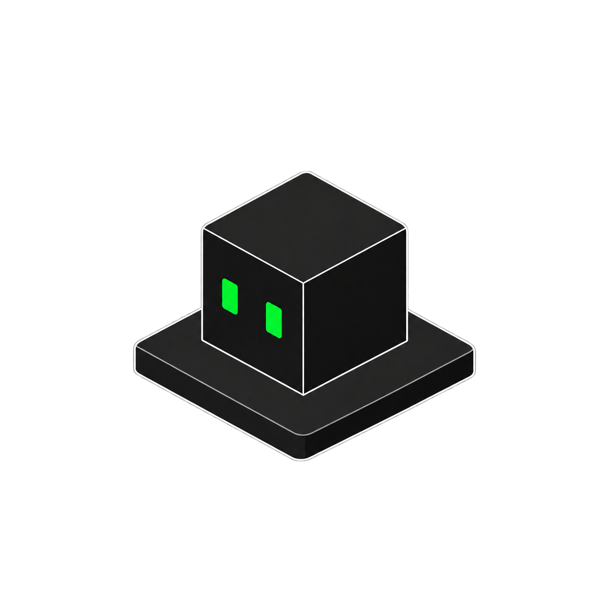
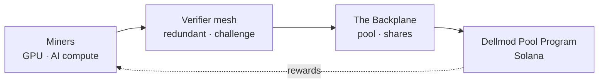

<p align="center">
  
</p>

<h1 align="center">Dellmod</h1>

<p align="center">
  <b>Proof-of-Useful-Compute mining for AI — settled on Solana.</b><br/>
  <i>Idle accelerators connect, miners execute useful work, verified compute settles into $DELLMOD.</i>
</p>

<p align="center">
  <a href="https://github.com/dellmodrun/Dellmod/actions/workflows/ci.yml"></a>
  <a href="https://github.com/dellmodrun/Dellmod/actions/workflows/docker.yml"></a>
  <a href="https://github.com/dellmodrun/Dellmod/pkgs/container/dellmod"></a>
  <a href="https://dellmod.fun/"></a>
  
  <a href="LICENSE"></a>
  <a href="https://x.com/dellmodrun"></a>
</p>

---

## Table of contents

- [What is Dellmod?](#what-is-dellmod)
- [Why Proof of Useful Compute?](#why-proof-of-useful-compute)
- [How it works](#how-it-works)
- [Architecture](#architecture)
- [Quickstart](#quickstart)
- [Engine API](#engine-api)
- [HTTP API](#http-api)
- [Tokenomics](#tokenomics)
- [Project structure](#project-structure)
- [Roadmap](#roadmap)
- [Contributing](#contributing)
- [Security](#security)
- [License](#license)
- [Disclaimer](#disclaimer)

---

## What is Dellmod?

The world is full of **idle accelerators** and **hungry AI workloads**, yet the two rarely meet in a
market that pays fairly for real work. Classical crypto mining burns electricity on hashes that
secure a ledger but produce nothing else; proof-of-stake pays capital for holding capital.

**Dellmod proposes a third path:** a network where miners earn the native token **$DELLMOD** by
contributing *verifiable AI computation* — inference and training jobs — instead of wasted hashpower.
Work is metered in verified TFLOP-hours, checked by a redundant verifier mesh, pooled in an open
mining pool (the **Backplane**), and settled on **Solana**.

Like a modular compute backplane, Dellmod turns scattered accelerators into coordinated,
verifiable capacity that settles into value.

> **Status:** pre-launch. The $DELLMOD token launches first as a fair, community-owned coin; the
> mining network in this repo is the reference implementation being built on top of it. The dashboard
> currently shows clearly-labelled **sample telemetry**.

- 🌐 **Website:** https://dellmod.fun/
- 📈 **Live dashboard:** https://dellmod.fun/terminal.html
- 📄 **Whitepaper:** https://dellmod.fun/index.html
- 🪙 **Buy $DELLMOD:** https://pump.fun/coin/9yYDtrYBFq1prcjE92VmEHtpMzsF8v51PdfiaEUDpump

---

## Why Proof of Useful Compute?

| Mechanism | Miners are paid for… | Byproduct |
|-----------|----------------------|-----------|
| Proof of Work | guessing hashes | heat |
| Proof of Stake | locking capital | — |
| **Proof of Useful Compute** | **running real AI jobs** | **useful inference / training** |

The hard part is paying for a computation **without re-running it yourself**. Dellmod combines cheap
statistical checks with an economic dispute game so that honest computation is the only strategy that
pays (see [`engine/verify.py`](engine/verify.py)).

---

## How it works

Each job flows through four stages — one **verified execution**:

```
  ┌──────────┐     ┌────────┐     ┌───────────────────┐     ┌──────────┐
  │ Dispatch │ ──▶ │ Execute │ ──▶ │      Verify       │ ──▶ │  Settle  │
  │ job→miner│     │ run AI │     │ redundant+challenge│     │mint DELLMOD│
  └──────────┘     └────────┘     └───────────────────┘     └──────────┘
```

1. **Dispatch** — a job with a known compute profile is sent to a miner (and, with probability `s`, a shadow miner).
2. **Execute** — the miner runs the model and returns the output plus a commitment.
3. **Verify** — redundant sampling + an economic challenge window catch fabricated work.
4. **Settle** — verified work is aggregated per epoch and paid out in $DELLMOD on Solana.

The probability a fabricated result escapes **both** checks is bounded by `P_escape = (1 − s)(1 − p_c)`.
With slashing above the expected gain from cheating, honest work is the unique profitable strategy.

---

## Architecture



- **`engine/emission.py`** — disinflationary $DELLMOD emission with halving eras.
- **`engine/pool.py`** — the Backplane: verified-work share accounting and reward split.
- **`engine/verify.py`** — the Proof-of-Useful-Compute verification game.
- **`engine/network.py`** — miner/network model and the telemetry snapshot builder.
- **`engine/pipeline.py`** — writes `data.json` for the dashboard.
- **`engine/server.py`** — stdlib HTTP server for the static site + JSON API.

---

## Quickstart

```bash
# 1. clone
git clone https://github.com/dellmodrun/Dellmod.git
cd Dellmod

# 2. install dev deps (runtime is stdlib-only)
python -m pip install -r requirements.txt

# 3. run the test suite
python -m pytest -q

# 4. build the dashboard telemetry
python -m engine.pipeline          # writes ./data.json

# 5. serve the site + API
python -m engine.server            # http://localhost:8777
```

### Docker

```bash
docker build -t dellmod .
docker run -p 8777:8777 dellmod
# or pull the published image:
docker run -p 8777:8777 ghcr.io/dellmodrun/dellmod:latest
```

---

## Engine API

```python
from engine import emission, pool, verify

# --- emission: halving schedule ---------------------------------------------
emission.emission(0)                      # 20000.0  (era-1 per-epoch)
emission.emission(emission.DEFAULT_HALVING)  # 10000.0  (halved)
emission.max_supply()                     # 1_000_000_000.0  (hard cap)

# --- pool: split an epoch's emission by verified work -----------------------
pool.reward_split({"abyss": 30.0, "kraken": 10.0}, epoch_emission=100.0, fee=0.015)
# -> {'abyss': 73.875, 'kraken': 24.625}

# --- verify: is cheating deterred? ------------------------------------------
verify.escape_probability(sampling_rate=0.3, challenge_prob=0.3)   # 0.49
verify.is_cheating_deterred(gain=100, stake=10_000,
                            sampling_rate=0.3, challenge_prob=0.3)  # True
```

---

## HTTP API

The server exposes the same telemetry the dashboard consumes:

| Route | Description |
|-------|-------------|
| `GET /` | the whitepaper (`index.html`) |
| `GET /terminal.html` | the live network dashboard |
| `GET /api/network` | telemetry snapshot (JSON) |
| `GET /api/health` | `{"status":"ok","version":"…"}` |

```bash
curl http://localhost:8777/api/health
curl http://localhost:8777/api/network | python -m json.tool | head
```

---

## Tokenomics

**$DELLMOD** is the network's unit of account — customers pay for compute in it, miners earn it,
verifiers are bonded in it. Emission halves every era so early growth is well rewarded while supply
is capped.

| Parameter | Value (preview) |
|-----------|-----------------|
| Ticker | **DELLMOD** |
| Max mined supply | 1,000,000,000 |
| Emission (era 1) | 20,000 / epoch |
| Halving interval | every 25,000 epochs (~2.85 yr) |
| Mining epoch | 1 hour |
| Pool fee | 1.5% |
| Settlement chain | Solana |

| Emission stream | Share | Recipient |
|-----------------|-------|-----------|
| Miner rewards | ~90% | verified compute providers |
| Verifier rewards | ~7% | challenge / redundancy work |
| Treasury | ~3% | protocol development |

> Figures are preview targets, subject to community calibration before mainnet.

---

## Project structure

```
Dellmod/
├── index.html            # whitepaper (static site root)
├── terminal.html         # live network dashboard
├── data.json             # dashboard telemetry (built by the engine)
├── assets/               # logo + favicons
├── engine/               # backend — the reference PoUC implementation
│   ├── emission.py        · halving emission schedule
│   ├── pool.py            · the Backplane mining pool
│   ├── verify.py          · verification game
│   ├── network.py         · miner model + telemetry builder
│   ├── pipeline.py        · writes data.json
│   └── server.py          · site + JSON API server
├── tests/                # pytest suite for the economic primitives
├── Dockerfile            # tiny stdlib-only image
└── .github/workflows/    # CI (tests) + container publish (ghcr)
```

---

## Roadmap

- [x] **Phase 0 — Fair launch.** $DELLMOD launches as a community coin.
- [ ] **Phase 1 — Testnet mining.** PoUC client, verifier mesh, the Backplane pool (preview telemetry — *live now*).
- [ ] **Phase 2 — Settlement.** `Dellmod Pool Program` deploys to Solana; epochs settle on-chain.
- [ ] **Phase 3 — Open market.** External customers submit paid AI jobs; rewards shift from emission to real demand.

---

## Contributing

Contributions are welcome — see [CONTRIBUTING.md](CONTRIBUTING.md). Keep the runtime dependency-free,
keep the economic primitives tested, and keep PRs small and focused.

## Security

Found a vulnerability? Please email **GitHub Issues** rather than opening a public issue.

## License

[MIT](LICENSE) © 2026 Dellmod Labs.

## Disclaimer

This repository is a technical and conceptual reference provided for information only. It is **not**
financial, investment or legal advice, and **not** an offer to buy any asset. $DELLMOD is a community
token; the mining network, settlement programs, parameters and emission figures here are design
targets that are **not yet deployed** and may change. Digital assets are volatile — never risk more
than you can afford to lose.
